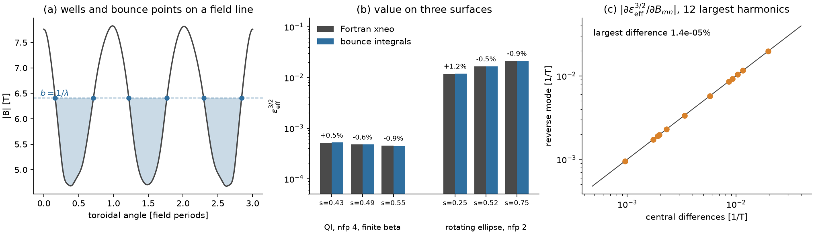
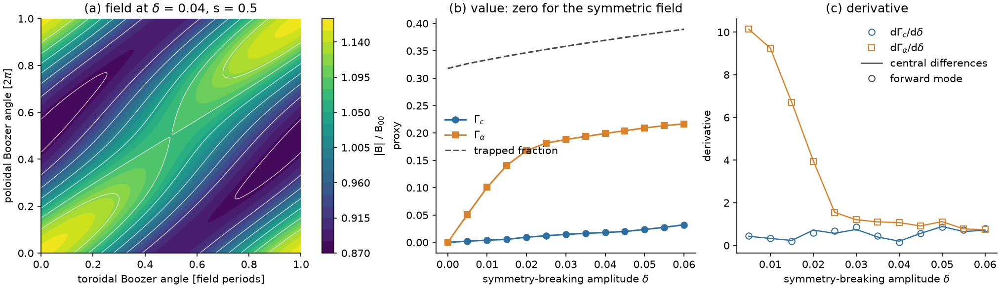

Applications and Examples
=========================

NEO_JAX is designed both as a production solver for Boozer-coordinate
transport analysis and as a building block for optimization, design-space
exploration, and differentiable workflows.

Example scripts
---------------

The repository ships executable examples in ``examples/``:

.. list-table::
   :header-rows: 1
   :widths: 42 58

   * - Script
     - Purpose
   * - ``ncsx_epsilon_effective_plot.py``
     - Computes :math:`\epsilon_{\mathrm{eff}}^{3/2}` on an NCSX fixture and
       plots the radial profile.
   * - ``ncsx_autodiff_Rmajor_optimization.py``
     - Demonstrates forward-mode differentiation with respect to a simple
       geometric scalar.
   * - ``epsilon_effective_scale_optimization.py``
     - Uses autodiff on a toy magnetic-field scaling problem.
   * - ``vmec_boozer_neo_pipeline.py``
     - Runs the in-memory VMEC→Boozer→NEO workflow without intermediate files.
   * - ``effective_ripple_gradient.py``
     - Evaluates the bounce-integral effective ripple, compares it with
       Fortran ``xneo`` and checks its reverse-mode gradient (figure below).
   * - ``fast_ion_proxies.py``
     - Scans a symmetry-breaking harmonic and checks the derivatives of
       ``Gamma_c`` and ``Gamma_alpha`` (second figure below).

Typical research uses
---------------------

NEO_JAX is well suited to:

- radial scans of :math:`\epsilon_{\mathrm{eff}}^{3/2}` on a fixed equilibrium
- design comparisons across Boozer or VMEC equilibria
- sensitivity analysis of ripple to geometry or current-profile changes
- gradient-based optimization where a differentiable approximation is useful
- automated studies in which the Python API is more convenient than text-file
  orchestration
- solver benchmarking across CPU, GPU, JIT, and Fourier-evaluation modes

Effective ripple as an optimization objective
---------------------------------------------

:func:`neo_jax.effective_ripple_3_2` returns :math:`\epsilon_{\mathrm{eff}}^{3/2}`
on every surface of a :class:`~neo_jax.data_models.BoozerData` and can be
differentiated in forward and reverse mode. Use it when the ripple is a term
of an objective; keep :func:`neo_jax.run_neo` when parity with Fortran
``xneo`` or its rational-surface treatment is what matters.

.. code-block:: python

   import jax
   from neo_jax import RippleBudget, effective_ripple_3_2

   values = effective_ripple_3_2(booz)                 # one value per surface
   cost = lambda b: effective_ripple_3_2(b, RippleBudget(n_lines=16)).sum()
   gradient = jax.grad(cost)(booz)                     # BoozerData of derivatives

   (a) ``|B|`` along a Boozer field line of a quasi-isodynamic surface; at each
   pitch the wells are bounded by exact bounce points. (b) The value against
   Fortran ``xneo`` on three surfaces of two equilibria; the labels are the
   relative differences. (c) Reverse-mode derivatives with respect to the twelve
   largest ``|B|`` harmonics against central differences.

What it is for:

- a ripple term in a fixed-boundary optimization: the gradient with respect to
  the boundary follows by the chain rule through the equilibrium and the
  Boozer transform (``vmex.core.neoclassical`` does this for VMEX states);
- sensitivities of the ripple to individual Boozer harmonics, as in panel (c);
- surveys of many equilibria: one surface takes about a second on a CPU at
  the default :class:`~neo_jax.RippleBudget`, and one reverse pass about three
  times that.

Two cautions. The value is the caller's to converge: the default budget holds
1% against a three times larger one on the validation set, and
``RippleBudget`` sets the cost. Near-omnigenous fields need the equilibrium
itself solved tightly (force tolerance 1e-12), because the geodesic integral
cancels inside each well (:doc:`validation`).

Fast-ion proxies
----------------

:func:`neo_jax.fast_ion_proxies` returns :math:`\Gamma_c`, :math:`\Gamma_\alpha`
and the trapped fraction on the interior surfaces of a
:class:`~neo_jax.data_models.BoozerData` (each surface uses two neighbours on
each side for the radial derivatives). :math:`\Gamma_c` measures how far the
contours of the second adiabatic invariant depart from the flux surfaces
(Nemov et al. 2008); :math:`\Gamma_\alpha` estimates the fraction of trapped
alphas whose precession carries them to an outward superbanana (Velasco et al.
2021). Both vanish for an omnigenous field and both are differentiable.

.. code-block:: python

   import jax
   from neo_jax import FastIonBudget, fast_ion_proxies

   gamma_c, gamma_alpha, trapped = fast_ion_proxies(booz)   # five or more consecutive surfaces
   cost = lambda b: fast_ion_proxies(b, FastIonBudget(n_lines=32))[1].sum()
   gradient = jax.grad(cost)(booz)

   (a) An analytic quasi-helical field with a symmetry-breaking perturbation of
   relative size :math:`\delta`. (b) Both proxies are zero for the symmetric
   field and grow with :math:`\delta`. (c) Forward-mode derivatives against
   central differences (step 2e-4).

What it is for:

- a fast-ion term next to the effective ripple in a stellarator optimization
  (``vmex.core.fastion`` provides the terms for VMEX states);
- ranking configurations before running a guiding-centre loss calculation;
- sensitivities of fast-ion confinement to individual Boozer harmonics.

Cautions. :math:`\Gamma_\alpha` here is a smoothed form of the published
definition: the thresholds at :math:`|\gamma_c^*| = 0.2` are smooth steps and
the first-passage rule is a continuous hazard, which is what makes it
differentiable. On fields with many wells close to the threshold it differs
from the sharp value (numbers in :doc:`validation`), so treat it as an
objective and a ranking, and check candidates with orbit following. Neither
proxy is a loss law. The value of :math:`\Gamma_c` converges faster than its
derivative: with 16 field lines the slope carries sampling noise, visible in
panel (c), so use more lines when the gradient direction matters.

Example: radial survey from a Boozer file
-----------------------------------------

.. code-block:: python

   from neo_jax import NeoConfig, run_neo

   config = NeoConfig(
       surfaces=[0.1, 0.2, 0.4, 0.6, 0.8],
       theta_n=96,
       phi_n=96,
       npart=64,
       multra=2,
   )
   results = run_neo("boozmn.nc", config=config)

   for s, eps in zip(results.s, results.epsilon_effective):
       print(f"s={s:.3f}  eps_eff^(3/2)={eps:.6e}")

Example: in-memory pipeline
---------------------------

.. code-block:: python

   from neo_jax import NeoConfig, run_vmec_boozer_neo

   config = NeoConfig(surfaces=[0.3, 0.5, 0.7], theta_n=64, phi_n=64)
   results = run_vmec_boozer_neo(
       "input.vmec",
       booz_kwargs=dict(mboz=12, nboz=12),
       neo_config=config,
   )

Optimization and autodiff
-------------------------

The main autodiff use cases in the repository are deliberately simple and
transparent:

- changing a scalar geometry parameter and differentiating the resulting
  :math:`\epsilon_{\mathrm{eff}}^{3/2}`
- reusing a prebuilt JAX solver inside an outer optimization loop
- studying tradeoffs between ripple and secondary geometric objectives

For repeated solves, prefer :func:`neo_jax.build_vmec_boozer_neo_jax` so the
static geometry setup is compiled once and reused:

.. code-block:: python

   from neo_jax import NeoConfig, build_vmec_boozer_neo_jax

   solve = build_vmec_boozer_neo_jax(
       run,
       booz_kwargs=dict(mboz=10, nboz=10),
       neo_config=NeoConfig(surfaces=[0.5]),
       jit=True,
   )
   outputs = solve(run.state)

Comparison workflows
--------------------

NEO_JAX also supports direct comparison against existing output decks and
reference cases when that is scientifically useful. Those comparisons are
documented in :doc:`validation` and :doc:`testing`; they are intended as
evidence for correctness, not as the primary framing of the code.
